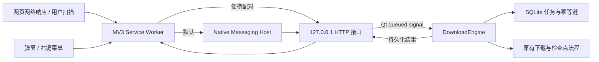
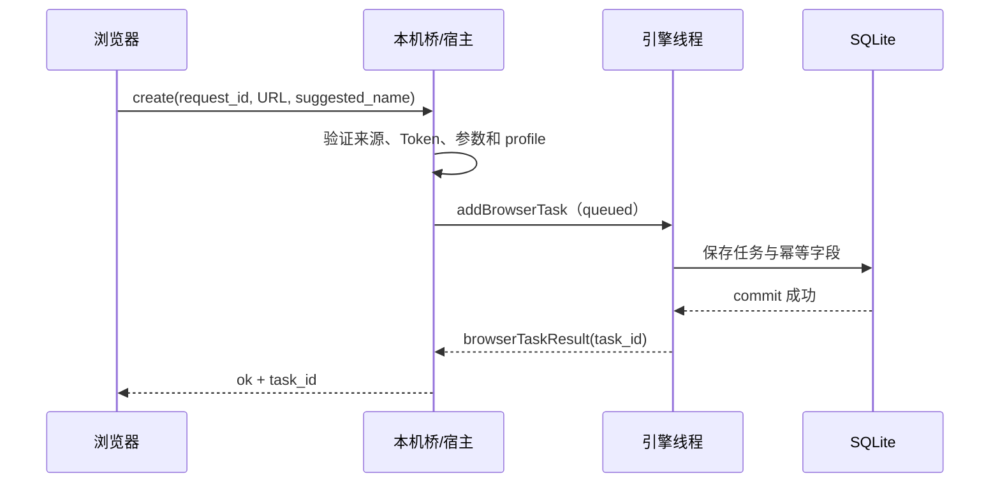
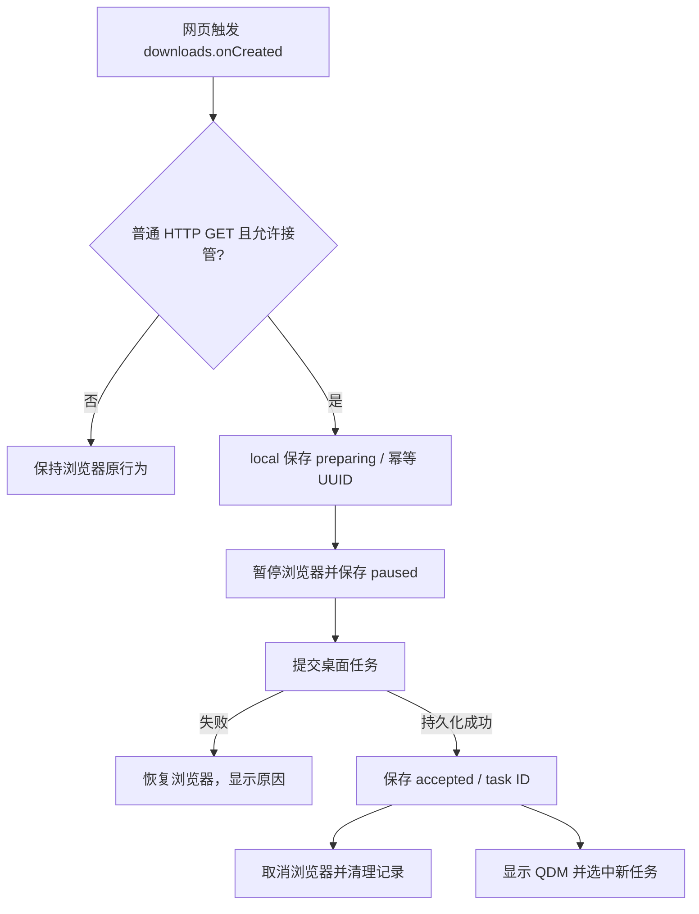

# QDM 浏览器扩展与桌面桥接（0.2.1）

## 已实现的软件边界

Chrome/Edge Manifest V3 扩展为 `browser-extension`；桌面 Qt 仍为 5.8.0/v120。普通 HTTP/HTTPS、直接音视频、图片、文档及程序链接由原下载引擎执行。HLS/DASH 只识别清单，尚不做媒体合并。不读取 Cookie；扩展 0.2.0 已增加可关闭的普通下载自动接管。



本机宿主复用同一个鉴权接口，而不是另外维护一套下载实现。浏览器的“已添加”表示引擎已经保存任务；不表示网页中的流媒体已经成功解析。

## 文件与阅读顺序

| 文件 | 职责 |
| --- | --- |
| browser-extension/manifest.json | MV3、稳定公开 key、权限和入口 |
| browser-extension/model.js | 纯函数：HTTP URL、资源分类、文件名、配对校验、候选项上限 |
| browser-extension/background.js | 同步注册监听器、session 状态串行化、受信扩展页面消息、桌面通信 |
| browser-extension/scan.js | 用户点击后读取 DOM 中的链接与媒体地址，不注入页面脚本 |
| popup.html/js/css | 当前标签候选项、筛选、复制、手动地址和提交结果 |
| options.html/js | Native/便携模式、配对信息和测试连接 |
| src/browserbridge.h/.cpp | GUI 线程本机服务、HTTP 限额、鉴权、输出路径规划和异步应答 |
| src/browserprotocol.h/.cpp | 共用协议常量、系统随机数、DPAPI 密钥和安全文件名 |
| native-host/main.cpp | stdin/stdout 帧、浏览器来源验证和有界 HTTP 转发 |
| scripts/register-native-host.ps1 | 当前用户 Chrome/Edge 宿主注册和撤销 |
| tests/extension.test.mjs | 前端纯逻辑和 MV3 状态/来源测试 |
| tests/browser_bridge.py | 真实宿主、HTTP、迁移、幂等和输出摘要测试 |
| tests/extension_browser.py | 临时真实 Chrome/Edge：加载扩展→资源识别→桌面下载 |

## 资源识别与 MV3 生命周期

`webRequest.onHeadersReceived` 非阻塞观察 HTTP(S) 成功响应，依据 MIME、Content-Disposition 和 URL 路径分类。识别 m3u8/MPD，但排除典型 ts/m4s 媒体小分片，避免把数千个分片填满候选列表。状态码异常或无标签的扩展自身请求不进入资源列表。

候选项保存在 storage.session，按标签导航或关闭清除；每标签最多 100 条、全局 400 条。URL 限制为 8192 字符，资源不保存在 storage.sync。候选资源有会话 UUID，用于幂等提交；不会把 URL 查询参数删掉或改变签名内容。

worker 全局内存不是持久化依据。事件监听器在模块顶层同步注册，资源读改写通过串行 Promise 队列执行，防止异步配置读取跨过导航清空事件。worker 重启后从 session 恢复候选项。

消息入口只接受当前扩展的 popup.html/options.html。不能单凭 sender.id 判断可信，因为注入网页的扩展脚本也有同一个 ID；也不能单凭 sender.tab 判断不可信，因为选项页可能就是扩展标签页。实现验证 sender.url 的精确扩展页面地址。

弹窗用 textContent 绘制文件名和来源，不将网页提供的标题/文件名插入 HTML。没有远程脚本、动态 eval、externally_connectable 或自动 Cookie 提取。

## 桌面线程和执行顺序

BrowserBridge 及其 QTcpServer/Socket 属于 GUI 线程。引擎和 SQLite 仍归下载工作线程。HTTP 请求验证完成后发 submit，经 queued connection 进入 addBrowserTask；后者复用 enqueueTask，不直接访问 QWidget。



请求 Socket 以 QPointer 保存，即使浏览器关闭弹窗或超时断开也不访问悬空指针。引擎后续成功时仍保留任务，客户端重试相同 request_id 会找回原任务。

## 本机协议

桌面默认监听 `127.0.0.1:17878`，不会监听所有网卡。测试允许 `--bridge-port 0` 动态端口。普通 headless 下载不启动服务；`--headless --serve` 用于隔离测试。

所有正常请求必须包含：

```text
Authorization: Bearer <64位十六进制随机Token>
X-QDM-Extension-Id: nkblcdnjneadmggjpnjajlbebpbmhjpj
Host: 127.0.0.1:<当前端口>
```

Origin 存在时必须是固定的 chrome-extension 来源；没有 Origin 时仍必须通过 Token 和扩展 ID 检查，以适配宿主或浏览器背景请求。OPTIONS 仅对该扩展 Origin 返回 CORS 许可，普通网页不获许可；CORS 不是 Token 的替代品。

| 接口 | 返回 |
| --- | --- |
| GET /api/v1/health | API 版本、桌面版本、默认 profile 和并发、可用能力 |
| POST /api/v1/tasks | 校验并持久化任务后返回 task_id；重试返回原任务 |
| GET /api/v1/tasks/{UUID} | 文件名、状态、已写入量、总量；不返回 URL 或凭据 |

POST 字段仅允许字符串类型的 request_id、url、suggested_name、profile_id、source_page。request_id 长度 8～80；URL 只允许无内嵌账号密码的 HTTP(S)，最大 8192 字符；profile 只允许 default。source_page 不作为登录凭据或 Referer 转发。

接口不接受本地绝对输出路径、命令、文件删除或读取操作。文件名会清理路径穿越、保留设备名和非法字符；重名加序号，目标始终来自桌面受控目录。下载目录及默认并发由“浏览器扩展”对话框设置并持久化。

HTTP 解析器限制：16 KiB 头、64 KiB 正文、最多 16 个活跃客户端、10 秒期限；只实现 HTTP/1.1 单请求，拒绝重复头、折叠头、Transfer-Encoding、管线请求和不规范 Content-Length。所有响应 no-store，连接关闭，不作为通用 Web 服务器使用。

主要错误：401 未配对；403 Host/Origin 错误；400 参数或创建失败；409 幂等键冲突；413 大小/长度非法；422 尚不支持流媒体合并；429 过多请求。

## 密钥、发现与宿主

首次启用使用 Windows CryptoAPI 生成 32 字节随机数，转为 64 字符 Token；browser-secret.bin 经当前用户 DPAPI 保护。Token 在同数据目录重启时保持稳定，不输出到日志。browser-endpoint.json 只记录端口、PID 和 API 版本，正常退出清理。

Native Host 与桌面采用相同组织名/应用名和默认数据目录；便携模式看程序目录 portable.flag。自定义目录由注册脚本写 native-host-settings.json。宿主只能接受固定扩展 Origin，不接受网页或任意扩展。

宿主输入/输出为 4 字节小端长度前缀 + UTF-8 JSON，输入 1～65536 字节；stdin/stdout 都设二进制模式。只实现 health/create/status，可按协议持续读取多帧；日志不能写 stdout。阻塞网络等待只发生在这个独立辅助进程。

Chrome/Edge 注册位于当前用户的 NativeMessagingHosts，manifest allowed_origins 仅包含固定扩展 ID。注册脚本无需管理员，不会安装扩展、改变安全设置或终止应用。开发阶段提供脚本，尚未提供商店发布或签名安装器。

## 幂等与数据库升级

schema v2 增加 tasks.request_id、request_fingerprint，request_id 非空时建立唯一索引。普通桌面任务为 NULL，不影响创建多个任务。

请求摘要基于规范化 URL、安全文件名及 profile；相同键相同摘要返回原 task_id，不同摘要返回冲突。输出碰撞编号不进入摘要，避免重试时误报变化。数据库保存是幂等权威，内存 cache 只加速查找。

v1 升级前通过 SQLite backup API 保留 `tasks.sqlite.pre-v2.bak`，包括 WAL 已提交内容；备份失败不继续迁移。新增字段和版本更新在事务中执行。旧版不能打开 v2 数据库，升级后继续使用 0.2.0+；备份只是升级前快照，不代替日常数据备份。

## 验证入口

```powershell
.\scripts\build.cmd
$env:QDM_EXE = 'D:\project\QDM\build\release\bin\QDM.exe'
node --test tests\extension.test.mjs tests\takeover.test.mjs
python tests\browser_bridge.py
python tests\extension_browser.py --browser chrome
python tests\extension_browser.py --browser edge
python tests\integration.py
```

真实浏览器测试通过 DevTools 在临时 profile 加载扩展，只访问本机测试网页，配对本机隔离桌面实例并验证最终文件摘要；不加载用户默认浏览器资料，不改真实用户的宿主注册。需要 websocket-client 与本机相应浏览器。PowerShell 注册脚本另做语法解析，真实用户注册仍是安装步骤。

## 本次验证记录

- 前端 16 项测试通过：原资源/权限/worker 测试，以及交接顺序、离线恢复、关闭开关、排除下载、重启去重、取消重试和暂停失败。
- 原下载 18 项回归通过：`tests/work/5f01cfaca1`。
- 本机 HTTP/宿主/数据库 6 组验证通过：`tests/work/cbe91c234a/bridge`，包括 v1 一致备份、迁移后任务保留和重启幂等。
- 单实例和有序退出检查点通过：`tests/work/2fda6db4c3/instance`。
- Chrome 独立 profile 的真实链路通过：`tests/work/1177bd2dea/bridge/chrome`。
- Edge 独立 profile 的真实链路通过：`tests/work/c5926bd25f/bridge/chrome`（测试目录名沿用 chrome，不代表测试浏览器）。
- 两种浏览器都验证网页原始下载链接点击、桌面持久化后浏览器取消、最终 SHA-256、错误配对时恢复浏览器传输；桌面版本 0.2.1。
- 未在用户日常浏览器中安装或重新加载扩展。开发版 ZIP 位于 dist/QDM-browser-extension-0.2.0.zip；原 dist/QDM-browser-extension-0.1.0 解压目录保留加载路径并原位更新为 0.2.0，目录名不代表其中版本。更新时在扩展管理页重新加载并允许管理下载权限。

## 官方接口参考

- [Chrome webRequest](https://developer.chrome.com/docs/extensions/reference/api/webRequest)
- [MV3 service worker 生命周期](https://developer.chrome.com/docs/extensions/develop/migrate/to-service-workers)
- [Chrome Native Messaging](https://developer.chrome.com/docs/extensions/develop/concepts/native-messaging)
- [Edge Native Messaging](https://learn.microsoft.com/en-us/microsoft-edge/extensions/developer-guide/native-messaging)

## 自动接管状态机（扩展 0.2.0）



记录不另存 URL、路径、Cookie，仅保存浏览器 ID、请求 UUID、阶段和时间。重启后查询浏览器该 ID 的当前状态；accepted 只补取消，不重复建任务。尚未确认时复用 UUID 提交，桌面数据库保证去重。取消暂时失败后由 alarms 定期恢复；不能为了恢复而制造两份同时下载。

已知 POST、隐私窗口、其他扩展创建、用户已暂停、已完成、不安全下载以及 Blob/清单不自动接管。POST 识别只缓存最近一分钟的 URL/时间，不读取请求正文。已签名链接查询参数保持原样。登录 Cookie/自定义认证暂未转交，不宣称兼容所有鉴权下载。

新增 downloads 与 alarms 权限，旧扩展需要在管理页重新加载并允许新增权限。浏览器可能保留 USER_CANCELED 的已取消记录，扩展不擦除历史，也不关闭安全检查。Native 模式可以启动宿主同目录的 QDM.exe，并尽力交接前台许可；便携模式需要软件已运行，不能从网页执行任意本机命令。

当前只提供 build/release 运行版本；文中旧测试目录里的 baseline/optimized 路径属于历史诊断，不再是可用启动入口。手工源码已补充函数级中文注释，第三方代码保持上游原样。
