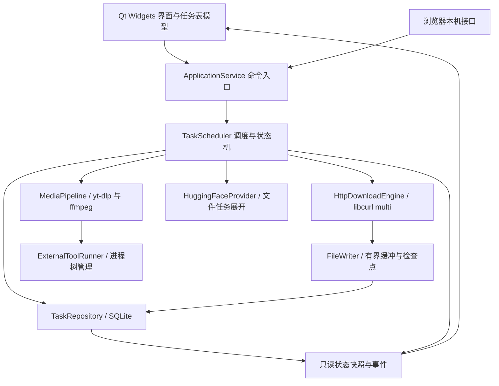
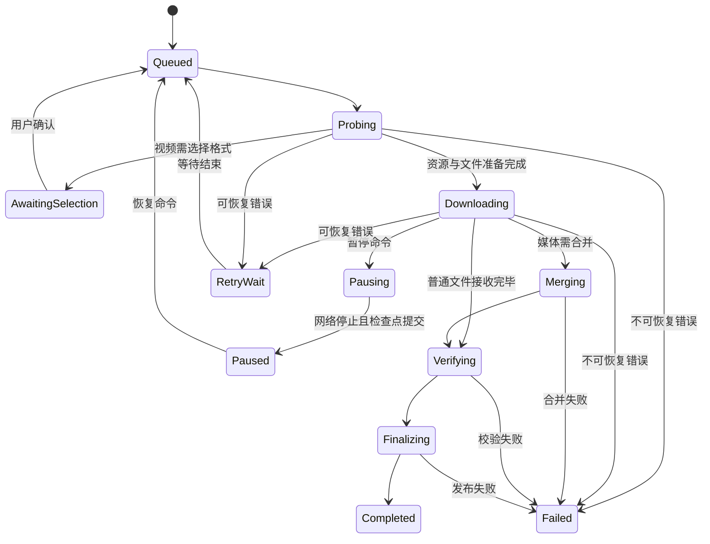
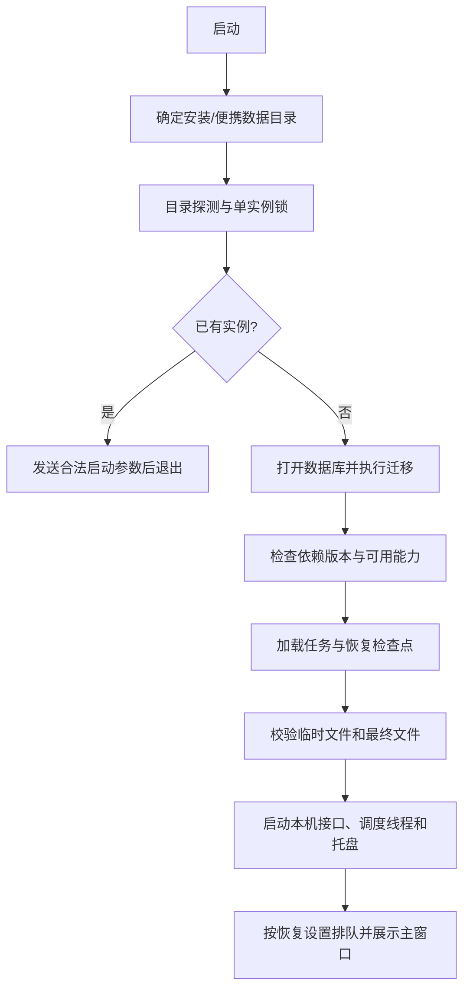
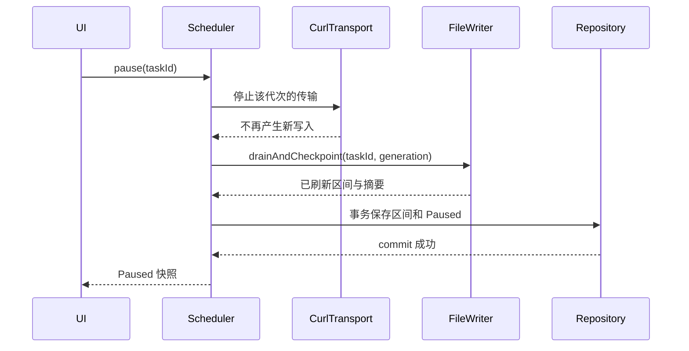

# QDM 技术方案与开发设计

> 文档日期：2026-11-14。状态：开发设计基线；HTTP 下载 MVP 已实现，实际进度及差异见第 19 节。
> 需求来源：同目录 `reademe.md`。本方案明确采用 Qt Widgets + C++ + libcurl + SQLite + yt-dlp/ffmpeg。
> Qt 固定为本机 `D:\Qt\Qt5.8.0` 中的 **Qt 5.8.0 / msvc2013_64**，不得直接套用 Qt 6 示例。

## 1. 产品目标与范围

面向 Windows 10/11 x64，实现普通文件、多媒体和模型文件的统一下载管理。主要界面包括任务列表、分类、搜索、任务详情、新建下载、视频格式选择、设置和系统托盘。

### 1.1 功能范围

| 领域 | 设计内容 | 交付阶段 |
| --- | --- | --- |
| HTTP/HTTPS | 分段下载、最高 64 路并发分段、单连接回退、暂停恢复、重试、限速 | 第一阶段 |
| 任务管理 | 批量添加、队列、分类、任务优先级、历史、删除记录/文件 | 第一阶段 |
| 可靠性 | 大文件写入、检查点、异常退出恢复、磁盘满处理 | 第一阶段 |
| Windows 集成 | 单实例、托盘、通知、打开文件/所在目录 | 第一阶段 |
| 浏览器扩展 | Chrome/Edge 资源发现、右键发送链接、本机任务提交 | 第二阶段 |
| 视频下载 | yt-dlp 解析与格式选择、下载、ffmpeg/ffprobe 合并与校验 | 第三阶段 |
| HLS/DASH | 首期委托 yt-dlp 处理受支持的非 DRM 点播资源 | 第三阶段 |
| HuggingFace | 模型仓库文件列表、固定 revision、鉴权、批量文件任务、清单校验 | 第四阶段 |
| 发布 | 安装版、目录式便携版、依赖与许可清单 | 各阶段持续验证 |

首期不承诺直播录制、DRM 解密、任意网站资源必定可下载、全功能浏览器内核、系统服务模式。关闭主窗口默认隐藏到托盘；明确退出会保存状态并停止下载，不承诺退出后继续下载。

README 中关于网站数量、扩展版本和现有产品行为的描述作为参考，不直接作为本项目验收结果。网站兼容情况由锁定的工具版本和实际样例验证。

### 1.2 名词约定

- **任务（Task）**：用户可见的下载项；一个模型仓库可包含多个子任务。
- **分段（Segment）**：普通文件内的半开字节区间 `[begin, end)`。
- **传输（Transfer）**：一个 libcurl easy handle 对应的请求。
- **并发数**：同时执行的传输数，不等于操作系统线程数。
- **已接收/已写入/已提交**：网络收到、写入文件、数据可靠落盘且恢复记录已提交，三者分别统计。
- **运行代次（generation）**：每次重新启动一个任务时递增，用于过滤旧回调。

## 2. 工具链和 Qt 5.8 约束

### 2.1 本机核实结果

通过实际执行 qmake 并检查本地头文件，已确认：

```text
Qt 根目录       D:\Qt\Qt5.8.0
Qt 套件目录     D:\Qt\Qt5.8.0\5.8\msvc2013_64
Qt 版本         5.8.0
qmake 版本      3.1
QMAKE_SPEC      win32-msvc2013
部署工具        D:\Qt\Qt5.8.0\5.8\msvc2013_64\bin\windeployqt.exe
现有 SQL 插件   plugins\sqldrivers\qsqlite.dll
```

已进一步找到 `D:\Program Files (x86)\Microsoft Visual Studio 12.0\VC\vcvarsall.bat`，并使用其中的 v120 x64 编译器实际构建运行 Qt 5.8.0 Release 程序。第一阶段编译脚本为 `scripts/build.cmd`，依赖及编译记录见 `docs/开发指南.md`。

### 2.2 编译策略

- 主程序：Qt 5.8.0 + MSVC 2013 x64/v120，qmake 工程，使用 VS2013 已支持的 C++11 子集。
- 不要求 C++14/17；不使用 `std::filesystem`、`std::optional`、`std::make_unique`、泛型 lambda 等较新语言/库特性。
- 文本文件统一 UTF-8。VS2013 源码使用 UTF-8 BOM，中文界面优先放在 `.ui`、`.ts`，避免依赖较新编译器的 `/utf-8` 开关。
- 第三方库必须区分 x64/x86、Debug/Release、运行库和工具集，禁止混用不兼容的 C++ 库。
- 不将 Qt 升级作为默认解决方式；若依赖无法满足此工具链，先采用独立 C ABI DLL 或独立进程隔离。

### 2.3 接口兼容规则

| 需求 | Qt 5.8 可用方案 | 禁止直接采用的较新写法 |
| --- | --- | --- |
| 跨线程调用 | QObject 信号槽、`Qt::QueuedConnection`、命名槽 `invokeMethod` | 较新 Qt 才支持的 functor `invokeMethod` 重载 |
| 文本编码 | `QTextCodec`、明确 UTF-8 解码 | Qt 6 `QStringConverter` |
| 进程 | `QProcess::setProgram`、`setArguments`、`start` | 较新版本的 `startCommand`、子进程修改器 |
| 列表 | `QAbstractTableModel` + `QTableView` | 为每个任务创建大量永久 QWidget |
| 磁盘容量 | `QStorageInfo` | 仅根据文件长度假定容量充足 |
| 本地通信 | `QLocalServer/QLocalSocket`、`QTcpServer/QTcpSocket` | 假定 Qt 自带较新 HTTP 服务模块 |
| 摘要 | `QCryptographicHash` | 未核实版本即可调用较新摘要 API |

Qt 5.8 自带的网络/TLS 组件不承担互联网文件传输；HTTP、HTTPS、代理和证书验证集中由 libcurl 负责。Qt Network 只用于本地 IPC 等明确用途。

## 3. 依赖设计

| 依赖 | 用途 | 集成策略 |
| --- | --- | --- |
| Qt Core/Gui/Widgets/Network | 界面、对象模型、本地通信、进程封装 | 固定本机 5.8.0，动态部署 |
| libcurl | HTTP/HTTPS、Range、代理、并发传输 | multi 接口；优先 Windows Schannel TLS 后端 |
| SQLite | 任务、分段检查点、设置、迁移 | 优先直接使用 sqlite3 C API，不依赖 Qt 5.8 内置 SQLite 版本 |
| yt-dlp.exe | 网站解析、视频/流媒体下载 | 独立进程、版本锁定、结构化输出 |
| ffmpeg.exe/ffprobe.exe | 合并、封装和媒体检查 | 独立进程，记录构建配置 |
| 可选 JS runtime | 满足特定 yt-dlp 站点能力 | 按锁定版本的要求配置，不默认认为仅有 yt-dlp 即可覆盖全部网站 |

### 3.1 老工具链与新网络库的边界

不为了兼容 v120 而直接选择多年未维护的网络库。先验证受维护 libcurl/SQLite 版本能否用 v120 构建；不能时，用较新工具链构建 **只导出 C ABI 的适配 DLL**，Qt 主程序仍保持 v120。

适配层遵守以下约束：

1. 导出函数使用 `extern "C"`、固定调用约定、固定宽度整数、带长度的 UTF-8 字节串和不透明句柄。
2. 不跨 DLL 传递 `QString`、STL 容器、C++ 异常、文件对象或任意 C++ 类。
3. 谁分配谁释放，提供配套 destroy/free 函数；回调参数的有效期写入接口注释。
4. 第三方运行库与 DLL 一同部署；用最小宿主验证 ABI、取消和生命周期，再接入业务。
5. DLL 内部可以使用较新 C++，不得把该要求传播到 Qt 主程序。

`dependencies.lock` 记录版本、来源、SHA-256、构建工具、架构、TLS 后端、运行库、许可和构建选项。本文不虚构已验证的具体 libcurl/SQLite/外部工具版本；第一阶段构建门禁必须产出该清单。

Schannel 使用 Windows 证书存储，默认保持证书链和主机名验证。需要其他 TLS 后端时，明确 CA 更新与部署机制，禁止通过关闭验证解决下载失败。

## 4. 软件架构与模块职责



图中表示逻辑依赖；跨线程边界必须使用命令和结果事件，不允许据此直接跨线程调用 QObject。

| 模块/类 | 主要责任 | 明确边界 |
| --- | --- | --- |
| `Application` | 初始化、依赖装配、启动和退出协调 | 不处理 Range 算法 |
| `ApplicationService` | 统一接收新建、暂停、恢复、删除命令 | UI 与浏览器入口共用校验 |
| `TaskScheduler` | 任务状态、并发额度、优先级、重试计划 | 唯一任务状态写入协调者 |
| `HttpDownloadEngine` | 探测、响应校验、传输管理 | 不直接操作 QWidget |
| `SegmentPlanner` | 划分半开区间、拆分剩余区间 | 不创建网络请求 |
| `CurlTransport` | libcurl 生命周期、回调、连接限制 | 不把 CURL 指针暴露给 UI |
| `FileWriter` | 有序写入命令、偏移写、落盘、检查点摘要 | 不负责决定任务最终成功 |
| `TaskRepository` | SQL、事务、迁移、任务快照 | 连接仅由持有线程使用 |
| `RecoveryService` | 校验任务、临时文件、检查点和最终文件 | 不信任仅有数据库的字节计数 |
| `MediaPipeline` | 解析、格式选择、下载、合并、验证步骤 | HLS/DASH 首期不重复造解析器 |
| `ExternalToolRunner` | 启动、行缓冲、退出码、超时和取消 | 不用拼接 shell 命令执行工具 |
| `BrowserBridge` | 本机协议、鉴权、限额、输入验证 | 不接受任意命令和任意输出路径 |
| `HuggingFaceProvider` | revision 固定、文件清单、批任务 | 不以临时签名 URL 作为永久身份 |
| `TaskTableModel` | 展示快照、排序筛选的数据源 | 不拥有下载引擎 |
| `SettingsService` | 配置及便携目录策略 | 敏感信息不写明文普通配置 |

## 5. 线程模型、所有权与性能

### 5.1 线程划分

| 执行上下文 | 对象和工作 | 约束 |
| --- | --- | --- |
| GUI 主线程 | 窗口、模型、托盘、ApplicationService | 不做阻塞网络、哈希、大文件 I/O |
| 调度工作线程 | Scheduler、HttpDownloadEngine、CurlTransport、进程异步对象 | 持有 Qt 事件循环；每轮网络处理有界 |
| 文件写线程 | FileWriter、顺序消费偏移写入队列 | 同一文件由单一写入所有者操作 |
| 数据库线程 | Repository、SQLite 连接、迁移和事务 | 首期单连接单线程，数据库命令串行 |
| 有限计算工作池 | 完整文件校验、较大清单计算 | 通过任务代次取消，不直接回调界面 |

QObject 移动到线程时不能带不兼容的父对象；QTimer、QProcess 等在线程归属确定后创建。自定义跨线程值类型使用 `Q_DECLARE_METATYPE` 和 `qRegisterMetaType`，先注册再建立 queued connection。

UI 接收不可变快照，每 200 ms 左右合并更新一次；状态变化即时通知。字节计数使用 64 位整数，不按每个网络回调刷新整张表。

### 5.2 网络循环

- libcurl 在引擎开始工作前完成一次全局初始化；所有传输关闭并退出工作线程后再全局清理。
- 所有 multi/easy handle 仅由其所属网络线程访问；其他线程发出命令，不直接 remove/cleanup。
- 0.1.0 的固定周期 QTimer 驱动 `curl_multi_perform` 已确认会限制部分 TLS 下载的吞吐；0.1.1 已改用 socket/timer 回调接入 `QSocketNotifier`，不再作为推荐方案保留固定 20 ms 轮询。
- socket 就绪时立即执行 `curl_multi_socket_action`；libcurl 的超时由独立单次 QTimer 管理。不得在 Qt 工作线程长时间等待网络而阻塞任务命令。
- Qt 5.8 的激活信号含 int，但 Windows SOCKET 为指针宽度，必须捕获原始句柄；监视器禁用/延迟销毁和句柄复用均需保护。
- 任何代码不得从 libcurl 回调内部立即销毁当前 handle；记录意图，在安全调度点统一处理。

### 5.3 缓冲与反压

默认建议值：全局同时下载任务 3 个，每任务初始 4 路，最大 64 路；全局传输上限 64 路，每主机初始上限 8 路。有效并发取各级额度最小值；用户提高单任务并发时仍受全局/主机设置约束。

建议最小分段 8 MiB，剩余数据不足时减少并发。64 是允许配置的上限，不是每个文件都立即创建 64 个请求。

文件写队列初始上限 32 MiB，加上当前最大回调块和库内部缓冲形成明确预算。回调只有在整块数据复制入队成功后才返回成功；队列满则使用 libcurl 暂停语义，不消费本次数据，稍后由引擎恢复。恢复时可能重投同一数据块，必须避免重复计数和重复写入。

文件偏移采用 64 位；Qt/Windows 实现都必须验证超过 4 GiB。分段数据直接写入同一个 `.qdm.part` 的不重叠区间，完成后无需再次拼接整份大文件。单写线程避免共享文件指针并发 seek/write。

## 6. 数据模型与持久化

### 6.1 任务核心字段

| 实体 | 关键字段 |
| --- | --- |
| `tasks` | id、parent_id、kind、state、generation、source_identity、display_name、target_path、temp_path、total_bytes、committed_bytes、etag、last_modified、range_supported、retry_count、next_retry_at、error_code、created_at、updated_at |
| `segments` | task_id、segment_id、begin_offset、end_offset_exclusive、committed_end、state、generation |
| `checkpoints` | task_id、generation、segment_id、begin_offset、end_offset_exclusive、sha256、created_at |
| `media_jobs` | task_id、tool_version、format_id、workspace_path、stage、output_manifest |
| `task_groups` | id、provider、repository、resolved_revision、state |
| `settings` | key、value、updated_at |
| `schema_meta` | schema_version、application_version |

task id 使用 UUID；字节偏移存 SQLite INTEGER（有符号 64 位）；时间统一 UTC 存储并在界面转换。未知长度使用 NULL，不使用 0 代替未知。HTTP 文件任务中，每段 `committed_end` 位于 `[begin, end]`，全局 committed_bytes 只能从已提交段推导。

为 `tasks(state, next_retry_at)`、`tasks(parent_id)` 建索引；segments 主键为 `(task_id, segment_id)`，外键关联 tasks。避免把进度刷新逐次写入数据库。

### 6.2 SQLite 策略

- 使用 sqlite3 prepared statement 绑定参数，不拼接用户输入 SQL。
- 初始化启用外键，设置合理 busy timeout；本地磁盘数据库优先 WAL + `synchronous=FULL`，并设置 checkpoint 策略。
- 数据库、WAL、SHM 文件视为一个使用中的数据集，不能在程序运行时只拷贝主数据库作为备份。
- 网络共享或不适合 WAL 的介质单独验证，必要时采用 rollback journal；不得静默关闭同步来追求速度。
- 迁移在事务中进行，版本只在成功后更新；失败回滚。数据库由较新版本创建时拒绝直接降级写入。
- 数据库不可写时禁止启动新任务，并协调停止活跃任务，避免形成不能恢复的下载状态。
- 下载 URL 可能含签名或凭据；保留时按敏感数据策略处理，日志只记录脱敏形式。

### 6.3 文件与数据库的一致性

数据库事务不能同时覆盖普通文件写入。必须采用“先可靠写文件，再提交恢复记录”的单向顺序：

1. 网络线程给写入线程发送 `task_id + generation + segment_id + absolute_offset + bytes`。
2. 写入线程确认代次和区间合法，完成写入；短写按实际返回值处理，失败立即上报。
3. 定期（建议每 2 秒或新增 16 MiB）建立检查点屏障，屏障前的数据写完后，调用 `QFile::flush` 并检查结果，再经平台封装调用 `FlushFileBuffers` 确认系统级刷新；该步骤不以 Qt flush 替代。
4. 为检查点覆盖的固定块计算并保存 SHA-256；跨检查点的未满块也必须有明确区间，不能把未验证字节算成已提交。
5. 写线程返回可持久化区间和摘要，调度器向数据库线程提交事务；事务成功后才公布 committed 进度。
6. 数据库提交失败则保留旧 committed 值，任务进入持久化错误状态；不得继续乐观累计。

文件里可以存在比数据库记录更多的数据；恢复时忽略这部分并重新下载。恢复必须检查文件存在、长度、已提交区间摘要和资源身份，不能因预分配文件长度正确就认定下载完整。

这套协议降低异常退出风险，但不承诺在不遵守刷新语义的存储硬件上绝对不丢数据。恢复时发现检查点损坏，只回退受影响范围，不静默接受损坏数据。

## 7. 任务状态机



图示为主路径，实际状态转换表还必须覆盖以下规则：

- 所有活跃阶段均接受取消，进入 `Cancelling`，等待网络、写入、子进程、数据库命令收敛后进入 `Cancelled`。
- 暂停仅在 backend 支持的阶段开放；首期合并/校验阶段不承诺可暂停，可取消并在恢复时重做该阶段。
- `Failed/Cancelled` 的重试返回 Queued，分配新 generation；Completed 不响应重复的完成事件。
- 恢复时原 Probing/Downloading/Pausing/Merging/Verifying/Finalizing 等非终态先进入 `Recovering`，验证后转 Paused、Queued、Completed 或 Failed，不直接沿用旧状态。
- 删除任务记录与取消执行分离：先完成取消屏障，再删除记录；用户选择删除文件时才删除本任务拥有的工作文件。
- 状态变化及原因由 Scheduler 集中校验和持久化，UI 禁止直接改业务状态。

## 8. 软件执行流程

### 8.1 启动和恢复



数据目录不可写、迁移失败或单实例协议不匹配时，明确报错，不静默切换到另一数据库。工具缺失时禁用对应媒体功能，普通 HTTP 下载可继续可用。

恢复大文件时展示“正在检查已下载数据”，允许取消。存在 Finalizing 记录时，结合最终文件、临时文件、摘要和目标路径恢复完成结果，不把重命名后尚未更新数据库的任务直接当作丢失。

### 8.2 HTTP/HTTPS 下载

1. **添加**：校验 http/https URL、目标目录、文件名、重复任务和输出路径冲突，持久化 Queued。
2. **获取额度**：Scheduler 按优先级、公平性、全局及主机限制分配传输额度。
3. **探测**：可先 HEAD 获取元信息，但必须以实际 `Range: bytes=0-0` 响应验证分段能力；不能仅相信 Accept-Ranges。
4. **校验探测响应**：记录重定向后的资源元信息；206 必须检查 Content-Range、总长和正文长度。探测收到 200 时只读取所需信息后结束探测，不将整份响应留在内存。
5. **准备文件**：确定最终文件名，在同目录创建唯一临时文件，检查可写性与可用空间。预分配失败不得当作下载成功；已分配空间也不能替代后续写入错误处理。
6. **分段规划**：按大小和并发数生成不重叠区间。HTTP Range 的结束位置是闭区间，发送 `[begin,end)` 时转换为 `bytes=begin-(end-1)`。
7. **传输**：流式接收、入有界写队列，按实际成功写入统计；网络线程不等待大文件磁盘刷盘。
8. **检查点**：按第 6.3 节执行文件刷新与数据库事务，进度区分实时接收和可恢复进度。
9. **验证**：各段覆盖完整区间、长度正确；存在可信来源摘要时执行完整校验。无来源摘要时只能声明长度和传输一致性检查通过。
10. **完成发布**：写入 Finalizing 意图，刷新并关闭临时文件，在同卷重命名为最终文件；目标存在时按预先确定的重命名/询问策略处理，不覆盖无关文件。提交 Completed 后通知界面。

关键协议规则：

- Range 传输采用 identity 表示，避免自动内容解压破坏字节偏移；校验服务器实际 Content-Encoding。无法获得可寻址表示时降为不支持分段的完整下载。
- 恢复优先使用强 ETag 与 If-Range，只有 Last-Modified 时采用更保守验证；弱 ETag 不作为强校验器。服务器没有可靠身份信息时，默认重新下载或明确提示，不能无条件拼接旧片段。
- 预期 206 却得到 200：拒绝把响应写到原偏移，先停止该任务所有段，隔离旧数据，再整体回退/重新探测。
- 收到 416：重新核对总长度和已完成区间，不直接认定成功。
- 每次收到 headers 时先验证状态和范围，再开放正文写入；错误页、重定向正文不能进入分段文件。
- 重定向设置次数上限；跨来源不转发 Authorization、Cookie 等敏感请求头，协议降级需明确策略。
- 未知长度按单流下载；只有正常协议结束并完成后处理后才能标记成功。

### 8.3 暂停、恢复、取消



暂停请求立即显示“正在暂停”，完成屏障后才显示“已暂停”。恢复分配新代次、核实资源身份并从 committed_end 继续。任何旧代次进度、完成、写入和数据库响应均被丢弃或按幂等规则处理。

取消同样等待全部拥有者停止使用文件，之后才释放文件或删除。删除失败保留可诊断记录，禁止递归删除未经验证归属的目录。

### 8.4 重试与限速

- 超时、连接中断和部分 5xx：指数退避并添加抖动，初始建议 1 秒、最大 60 秒、连续失败最多 5 次，可配置。
- 429/503 优先尊重有效 Retry-After，并降低主机并发；达到上限后进入可手工重试的 Failed。
- 401/403、证书错误、磁盘满、校验失败：向用户展示明确原因，不按普通断网无限重试。签名过期可由 Provider 刷新地址后重试。
- 全局、任务、主机限速都由统一预算协调；可使用 libcurl 单传输限速作为底层保护，但不能把每连接限速简单视为全局限速。
- 进度、速度用实际字节与单调时钟计算；未知总大小时显示已下载量，不显示虚假的百分比和剩余时间。

### 8.5 视频与 HLS/DASH

1. 识别为网页视频或流媒体地址后创建 MediaPipeline 工作目录。
2. 使用锁定版本 yt-dlp 的 JSON 输出解析格式、清晰度、音轨、预计大小和标题；禁止依赖本地化终端文字解析元数据。
3. 用户选择格式后保存 format id 和解析来源，再调用 yt-dlp 下载。使用明确的参数数组和 `--` 等选项边界处理 URL，工具行为以锁定版本验证。
4. 此路径由 yt-dlp 负责自己的分片和断点文件，QDM 不再用 HTTP 引擎对同一媒体重复分段；两种 backend 的并发额度统一预算。
5. 音视频合并优先流复制；不支持时明确提示是否转码，不默认执行高负载转码。
6. ffmpeg 输出至工作目录的临时产物，利用 `-progress pipe:1` 等结构化进度接口；ffprobe 检查输出存在、流信息和可解释的时长。
7. 同时满足退出码、输出文件和验证条件后发布最终文件。完成前不删音视频源文件；合并失败可重试合并，避免全部重下。
8. yt-dlp 的流媒体恢复能力按 backend 实际能力展示，不能保证所有站点精确断点恢复。

ExternalToolRunner 同时持续读取 stdout/stderr，按字节流处理跨块 UTF-8 和未完整的行；内存日志有上限。默认禁用用户级 yt-dlp 隐式配置，显式设置输出模板、工具目录和本任务工作目录，防止本机配置改变既定行为。

所有进程通过绝对路径启动，使用 `setProgram` + `setArguments`；不经过 `cmd /c` 或 PowerShell。命令参数中的 Cookie、Token 和签名 URL 不进入普通日志。

Windows 进程树由平台层 Job Object 管理，取消必须终止工具及其后代。Qt 5.8 不依赖较新进程修改接口：媒体阶段引入专用进程宿主，通过 `CreateProcessW(CREATE_SUSPENDED)`、加入 Job、再恢复线程消除子进程逃逸窗口；无法设置 Job 时停止该次启动并返回错误。宿主与 QDM 建立受控 IPC，QDM 退出或 IPC 断开时关闭 Job，避免孤儿 ffmpeg。

### 8.6 HuggingFace

输入仓库 ID/URL → 解析并固定 commit revision → 获取文件清单和可用摘要 → 用户选择文件 → 创建组和子文件任务 → Provider 提供可刷新下载地址 → 走普通 HTTP 引擎 → 校验清单 → 汇总组状态。

默认实现普通 HTTPS 文件下载，不要求完整复刻 HuggingFace 专用缓存或去重传输协议。针对受限仓库、存储重定向和大文件链接刷新做独立适配验证。Token 经凭据层保护，不转发到任意重定向来源；无可信摘要时明确标记校验能力。远程路径必须清理 `..`、绝对路径和 Windows 保留名称，确保输出位于用户选定根目录内。

## 9. 浏览器扩展与桌面通信

扩展使用 Manifest V3，负责资源发现、候选资源筛选、右键菜单和任务提交。桌面程序负责真正下载。普通扩展网络观察不等于能获取所有媒体、Blob、加密或受保护资源，界面要说明资源发现能力边界。

### 9.1 两种连接方式

| 模式 | 用途 | 约束 |
| --- | --- | --- |
| Native Messaging + 本机宿主 | 安装版默认方式 | 注册宿主清单和扩展允许列表；宿主通过本地 IPC 转发给主实例 |
| loopback HTTP + 配对 Token | 便携版或可选模式 | 显式首次配对；只监听 127.0.0.1，端口和 Token 有明确发现机制 |

Native Messaging 在 Windows 需要注册宿主，不能宣传为“完全无注册且自动接管浏览器”。便携版本机服务只在程序运行时可用；首期通过用户复制连接信息到扩展完成配对，不预设固定弱密钥。

### 9.2 本机接口

建议最小协议：`GET /api/v1/health`、`POST /api/v1/tasks`、`GET /api/v1/tasks/{id}`。采用有上限的 Content-Length JSON 请求，明确拒绝未实现的分块请求和不支持的方法，限制请求头、正文、连接数与读取时间。Qt 5.8 下自行实现最小 HTTP 解析要有协议测试，不引入不受控的完整通用服务器。

提交示例（仅表示协议，不是有效凭据）：

```json
{
  "request_id": "extension-generated-uuid",
  "url": "https://example.com/file.zip",
  "suggested_name": "file.zip",
  "source_page": "https://example.com/",
  "profile_id": "default"
}
```

- `request_id` 作为幂等键，重复提交返回既有 task_id。
- Token 放鉴权头，扩展 Origin 做允许列表校验；CORS 不是鉴权替代品。
- 默认拒绝普通网页调用；不提供执行命令、任意本地读文件或任意删除接口。
- 浏览器不能直接指定任意绝对输出目录，只能选择桌面预先配置的 profile。
- 如需 Cookie/Referer，通过明确的按任务授权传递并限制来源；不在全局配置中记录完整浏览历史。

## 10. 界面设计

| 区域 | 内容 |
| --- | --- |
| 顶部工具栏 | 新建、批量添加、暂停、恢复、取消、搜索 |
| 左侧导航 | 全部、下载中、已暂停、已完成、失败、视频、音乐、程序、压缩包、模型 |
| 主任务表 | 名称、状态、大小、已下载、速度、进度、预计时间、分类 |
| 任务详情 | 来源、目录、实际并发、分段图、检查点、错误及重试、媒体阶段 |
| 设置 | 目录、并发、限速、代理、启动恢复、浏览器配对、工具路径、日志 |
| 托盘 | 显示主窗口、全部暂停、全部恢复、明确退出 |

采用 `QAbstractTableModel` + `QSortFilterProxyModel` + delegate 绘制进度，避免每行创建独立进度控件。状态、按钮可用性和错误提示从业务快照推导。

批量操作需逐任务给出结果；删除对话框区分“仅删除记录”和“同时删除文件”。任务错误保留错误码、用户可读原因和下一步建议。中文文本通过 `tr()` 和 `.ts` 管理。

## 11. 目录与工程组织

下面是完整版本的目标目录。当前 0.1.0 采用较小的扁平 `src` 结构，文件映射与后续拆分边界见 `docs/开发指南.md`，不代表图中所有模块都已完成：

```text
QDM/
  reademe.md
  技术方案.md
  QDM.pro                         # qmake 子目录工程入口
  app/app.pro                     # Qt 主程序
  src/
    app/                          # Application、依赖装配、启动退出
    ui/                           # Widgets、dialogs、models、delegates
    application/                  # ApplicationService、任务命令
    domain/                       # Task、Segment、状态和错误码
    scheduler/                    # 队列、额度、重试和状态转换
    download/                     # HTTP 引擎、探测和分段规划
    storage/                      # FileWriter、检查点和恢复
    persistence/                  # Repository、SQL 和迁移
    media/                        # MediaPipeline、格式模型
    providers/                    # HuggingFace 等资源来源适配
    integration/                  # BrowserBridge、本地 IPC
    platform/windows/             # Job、FlushFileBuffers、凭据封装
    common/                       # 日志、路径、计时等小型公共设施
  bridges/                        # 可选 C ABI DLL、进程宿主
  resources/                      # 图标、翻译、qrc
  browser-extension/              # 扩展源代码和协议说明
  third_party/                    # 依赖清单、许可、构建脚本
  tools/                          # 外部可执行文件部署目录
  packaging/                      # 安装器和便携包清单
  tests/                          # Qt Test、协议与恢复测试
  docs/                           # 构建、调试、状态表和变更记录
```

模块按职责拆分，不把数据库、网络回调、UI 和进程控制全部放入 MainWindow。域模型不依赖 UI，外部实现通过接口注入，便于替换和故障测试。

## 12. 代码注释与开发者阅读规范

### 12.1 必须覆盖的注释

用户要求“代码注释完整”，实现时作为代码评审和验收项执行。完整指足以解释职责、契约和复杂行为，不要求给每条赋值语句复述语法。

1. **文件头**：文件用途、所属模块、关键依赖、线程归属和相关方案章节。
2. **类注释**：职责、所有权、可调用线程、初始化/销毁顺序、不负责的事项。
3. **公共接口**：输入含义、单位和区间、前置条件、同步/异步、返回值、错误、取消和回调契约。
4. **字段注释**：字节单位、UTC/单调时间、可空语义、状态不变量；敏感字段标记禁止日志输出。
5. **算法注释**：Range 闭区间转换、内容编码、资源身份、重试、分段覆盖检查、完成发布条件。
6. **并发注释**：对象归属、锁保护字段、锁顺序、数据复制和回调有效期；禁止仅写“线程安全”而无解释。
7. **持久化注释**：写文件和提交数据库的顺序、崩溃窗口、恢复依据、迁移兼容性。
8. **平台/版本注释**：Qt 5.8/v120 限制和替代实现理由；引用涉及的接口或问题记录。
9. **错误路径注释**：为何可重试、为何回退完整下载、为何保留临时文件。
10. **测试注释**：测试场景、故障点、预期不变量，避免只写“测试函数 X”。

注释统一中文，类型与函数名采用清晰英文。关键接口使用 Doxygen 格式；实现变化必须同步更新注释。TODO/FIXME 要写具体条件与关联问题，不能以 TODO 代替恢复逻辑。

### 12.2 头文件注释示例

以下为兼容 Qt 5.8/v120 风格的设计示例，尚不是现有实现：

```cpp
/**
 * @file segment.h
 * @brief 普通文件分段的数据契约，对应技术方案第 6、8 节。
 *
 * 线程：以值复制跨线程传递；禁止多线程共享并修改同一实例。
 */
struct Segment
{
    qint64 begin;         ///< 起始字节偏移，包含，单位 byte。
    qint64 end;           ///< 结束字节偏移，不包含；必须大于 begin。
    qint64 committedEnd;  ///< 已可靠提交的连续前缀终点，begin <= 值 <= end。
    quint64 generation;  ///< 运行代次，用于拒绝暂停/重启前的迟到回调。
};

/**
 * @brief 协调任务状态和资源额度，不直接执行文件写入。
 *
 * 所有权：由 Application 在调度线程中创建并销毁。
 * 线程：所有槽在调度线程执行；外部使用 queued connection 发命令。
 * 退出：先停止传输和工具，再等写入与数据库屏障，最后释放对象。
 */
class TaskScheduler : public QObject
{
    Q_OBJECT
public:
    explicit TaskScheduler(QObject *parent = 0);

public slots:
    /**
     * @brief 异步暂停任务，保留已提交的文件数据。
     * @param taskId 已存在任务的 UUID。
     * @note 调用返回不代表已经暂停；结果通过 taskStateChanged 通知。
     * @note 重复暂停是幂等操作；不存在的 ID 返回明确错误事件。
     */
    void pauseTask(const QString &taskId);

signals:
    /// 仅在状态转换通过校验且持久化成功后发出。
    void taskStateChanged(const QString &taskId, int state);
};
```

### 12.3 实现中的关键注释示例

```cpp
// 内部区间为 [begin, end)，HTTP Range 的结束字节为闭区间。
// 先确认 end > begin，再做 end - 1，防止空段产生负偏移。
const QByteArray range = QByteArray::number(begin) + "-"
                       + QByteArray::number(end - 1);

// 旧代次回调可能在“暂停后立即恢复”时到达。
// 丢弃它可以避免旧请求覆盖本次运行的进度和完成状态。
if (eventGeneration != currentGeneration) {
    return;
}

// 必须先确认文件数据刷盘，再提交数据库中的可恢复位置。
// 若反过来，异常退出后数据库可能指向尚未可靠写入的数据。
// flushAndCommitCheckpoint 是异步协议，不允许在 GUI 线程等待。
requestCheckpoint(taskId, currentGeneration);
```

### 12.4 开发者阅读顺序

建议按 `main/Application` → `ApplicationService` → `TaskScheduler` → `HttpDownloadEngine` → `FileWriter/RecoveryService` → `TaskRepository` → `TaskTableModel/MainWindow` 阅读，再看媒体和扩展模块。

每个复杂模块补充一个短 README，列出入口、线程、核心不变量、正常流程、故障流程和相关测试。新增 backend 必须实现相同命令/事件契约，并声明暂停、恢复、限速能力。

## 13. 配置、安全和诊断

- 安装版数据放 `%LOCALAPPDATA%\QDM`；便携版以明确的 `portable.flag` 启用程序目录下 `data`，只读时报告错误，不悄悄切换位置。
- 安装版凭据可用 Windows DPAPI 当前用户保护；便携版默认不跨机保存凭据，用户可选择不记住。任何 DPAPI 密文不宣传为可跨用户/跨机使用。
- 应用日志按日期/容量轮转，区分任务错误和调试事件；输出任务 ID、代次、错误码，不记录 Token、Cookie、完整签名参数。
- 远程文件名需清理 Windows 保留名、路径分隔符、ADS 冒号、末尾点/空格和路径穿越。长路径在 Qt 5.8/Windows 组合中必须实测，首期超限明确报错。
- 应用层初期不提供静默自更新；依赖更新需校验来源、摘要/签名和回滚能力，不在任务运行中替换工具。
- 更新说明区分 Qt、网络库和外部工具；Qt 5.8 是固定的老版本基线，缺陷修复及维护策略必须作为发布记录的一部分。

## 14. 构建与发布流程

### 14.1 主程序构建示意

完整构建入口为 `scripts/build.cmd`，同时生成 curl 导入库并部署运行时。下列为其主程序构建步骤示意；单独使用前须准备第三方依赖与导入库，并进入正确的 VS2013 x64 开发环境：

```powershell
# 在仓库中创建独立构建目录，避免生成文件混入源代码。
New-Item -ItemType Directory -Force -Path build\release
Set-Location build\release
& 'D:\Qt\Qt5.8.0\5.8\msvc2013_64\bin\qmake.exe' ..\..\QDM.pro 'CONFIG+=release'
nmake
```

主程序 `.pro` 基础配置如下，依赖路径由单独 `.pri` 提供：

```qmake
QT += core gui widgets network
CONFIG += c++11
TEMPLATE = app
TARGET = QDM
win32-msvc2013:DEFINES += QDM_LEGACY_V120
# SQLite 使用 C API，因此此处不添加 Qt SQL 模块。
# 第三方 include/lib/运行时部署规则在受版本管理的依赖配置中声明。
```

### 14.2 发布包

```text
QDM/
  QDM.exe
  Qt5Core.dll / Qt5Gui.dll / Qt5Widgets.dll / Qt5Network.dll
  platforms/qwindows.dll
  imageformats/...                 # 按实际资源需求收集
  bridges/...                      # 适配 DLL 和进程宿主（如启用）
  tools/yt-dlp.exe
  tools/ffmpeg.exe
  tools/ffprobe.exe
  licenses/...
  dependencies.lock
  portable.flag                    # 仅便携包
```

使用 **本机 Qt 5.8 的** windeployqt 收集 Qt 依赖，再显式添加第三方 DLL、工具、运行库、许可和清单。windeployqt 不负责证明第三方依赖完整。直接使用 SQLite C API 时无需携带 qsqlite 插件。

便携版是可解压运行的目录，不等同于单 EXE。动态部署不自动完成许可义务；按实际 Qt 模块、libcurl、SQLite、yt-dlp 打包内容和 ffmpeg 构建选项整理分发材料。

## 15. 验证与验收

### 15.1 有实际价值的测试

| 类型 | 场景与断言 |
| --- | --- |
| 协议 | 正确/错误 206、忽略 Range 返回 200、416、未知长度、错误 Content-Range、编码变化、跨域重定向 |
| 身份 | ETag/Last-Modified 改变；恢复不得将新旧内容拼接 |
| 数据正确性 | 随机内容、空文件、小文件、大于 4 GiB 文件，输出与源 SHA-256 一致 |
| 故障恢复 | 在写入、系统刷新、DB 提交、重命名前后强制终止，重启后不越过可信检查点 |
| 并发控制 | 1/4/16/64 路，验证实际活跃传输数、全局/主机额度及无重复区间 |
| 状态竞态 | 连续暂停/恢复/删除，旧代次回调不能复活任务或删除新任务文件 |
| 存储 | 磁盘满、只读目录、短写、临时文件丢失、DB 锁定和迁移失败 |
| 媒体 | 解析失败、工具缺失、合并失败、取消进程树、IPC 断开，不留孤儿进程 |
| 本机接口 | 无效 Token、错误 Origin、超大/截断 JSON、重复 request_id、路径穿越 |
| 发布 | 无 Qt 开发环境的干净 Windows 10/11 x64 系统，含中文和空格路径 |

Range、状态机和恢复测试使用可控本地测试服务器与随机文件，不能依赖公网网站限速或可用性判断引擎正确性。网站功能另设小规模人工/集成样例，随工具版本更新。

Qt 模块测试可使用 Qt 5.8 Qt Test；C ABI 和独立 DLL 使用各自工具链测试。验证数据库一致性之外，还要对比文件摘要，不能只断言进度达到 100%。

### 15.2 性能与稳定性目标

- 以 Release 构建测量 UI 响应、空闲 CPU、峰值内存、磁盘队列、吞吐和失败率，记录机器/磁盘/服务端配置。
- 增大文件体积不应使内存占用线性增长；缓冲预算可观测且有上限。
- 在受控服务端比较单路与多路效果，不承诺公网环境固定倍数提速。
- 建议执行长时间稳定性下载及取消恢复循环；发现失败时保存脱敏诊断。
- 验收数值在首个可运行版本后根据实测设定，本文不把估算当作结果。

## 16. 实施顺序与完成条件

| 阶段 | 开发内容 | 完成条件 |
| --- | --- | --- |
| 0：环境闭环 | v120 Kit、Qt 最小程序、curl/SQLite ABI、TLS、工具版本清单 | 真实编译运行，完成干净机最小部署 |
| 1：可靠下载 MVP | 单流→分段、调度、写入、检查点、恢复、任务表、托盘 | 可控服务器数据校验及关键故障注入通过 |
| 2：浏览器联动 | 扩展、Native Messaging、便携配对、幂等提交 | 安装/便携两种模式验证，接口拒绝非法请求 |
| 3：媒体流程 | 格式解析、下载、合并、进程树、恢复阶段 | 成功/失败/取消/重启路径均有明确结果 |
| 4：模型与完善 | HF 固定 revision、组任务、凭据、限速优化 | 清单及摘要验证、受限仓库错误处理通过 |
| 5：发布 | 安装器、便携包、许可、使用及开发文档 | Windows 10/11 干净机验收 |

每个阶段交付可运行程序、变更说明和验证记录；公共接口及复杂逻辑注释完整后才算完成。实际进度见第 19 节，未实现功能不能作为已有产品能力展示。

## 17. 待实现阶段确认的事项

以下项目不阻碍方案采用，但进入对应开发阶段必须落实：

1. 已落实：本机 v120 编译器与 Windows SDK 可用，实际 Release 编译通过。
2. 已落实 MVP：libcurl 8.23.0 官方 x64 C DLL 与 SQLite 3.54.1 源码，摘要和构建方式已记录至 dependencies.lock；后续持续维护。
3. 默认并发、检查点粒度和性能目标的实测结果。
4. 浏览器扩展 ID、发布账号、安装版宿主注册方式。
5. HuggingFace 对受限仓库和特定存储后端的首批支持样例。
6. 视频站点样例、yt-dlp 的可选 JS runtime 及 ffmpeg 编译配置。

## 18. 参考依据

本机 Qt 信息以第 2 节命令结果和本地 Qt 5.8 头文件为准；以下在线资料用于理解依赖行为，使用具体 API 前仍需核对所锁定版本：

- [libcurl multi interface](https://curl.se/libcurl/c/libcurl-multi.html)：多传输事件模型。
- [curl 证书验证与 TLS 后端](https://curl.se/docs/sslcerts.html)：证书存储和验证策略。
- [SQLite PRAGMA](https://www.sqlite.org/pragma.html)：同步、外键及数据库配置。
- [SQLite WAL](https://www.sqlite.org/wal.html)：WAL 特性和使用限制。
- [yt-dlp 官方仓库](https://github.com/yt-dlp/yt-dlp)：工具参数、依赖及站点能力。
- [ffmpeg 官方文档](https://ffmpeg.org/ffmpeg.html)：进程参数、进度和媒体处理。
- [Chrome Native Messaging](https://developer.chrome.com/docs/extensions/develop/concepts/native-messaging)：宿主注册和通信。
- [Qt 开源许可说明](https://www.qt.io/development/open-source-lgpl-obligations)：分发条件；最终以采用版本的许可文本为准。

## 19. 0.1.0 实施记录

已建立 QDM.pro、可重复构建脚本、官方依赖引导脚本、Qt Widgets 主窗口和可运行 Release EXE。

已实现：HTTP/HTTPS 流式下载、单任务队列、最多 64 段配置、约 8 MiB 最小分段、Range 校验和单流回退、暂停恢复、SQLite/WAL/FULL、系统级文件刷新、已提交区间 SHA-256 校验、有限重试及 Retry-After、最终发布恢复、DPAPI URL 保护、单实例和托盘。

实际结构与设计差异：0.1.0 将调度、网络、文件、数据库串行置于同一工作线程，用单任务 JSON 检查点原子保存；尚未拆出独立写线程/数据库线程、多任务并发和 generation。libcurl 实际采用官方 Windows 包的 LibreSSL + Native CA，而非自行构建 Schannel。上述选择及限制见 `docs/开发指南.md`。

验证使用 `tests/integration.py` 的真实 EXE 和本机 HTTP 服务，覆盖分段、单流、未知长度、空文件、重定向、错误响应、暂停、强制终止、损坏检查点、身份变化、429 重试及发布恢复等场景；最终文件与测试源进行 SHA-256 比对。另使用官方公开文件验证 HTTPS 证书验证开启时可正确下载。

尚未交付：浏览器扩展、媒体工具、HuggingFace、限速界面、多任务公平调度、安装器和全部性能/大文件/干净系统验收。后续实现继续遵循本方案的线程、注释与故障恢复要求。

## 20. 0.1.1 吞吐修正

用户反馈 4 路约 2 MB/s、8 路约 4 MB/s、64 路约 32 MB/s，提示固定调度间隔可能约束每条连接的数据处理。使用本机 TLS 服务进行版本对照后，确认旧网络驱动会呈现并发增加时吞吐近似线性上升的现象。

0.1.1 以 QSocketNotifier + libcurl socket_action 和单次超时代替固定 20 ms 网络轮询，保留现有 SHA-256、系统级刷盘、SQLite 检查点及证书校验。4 路本机诊断从约 21.8 MiB/s 提升至 135.4 MiB/s。该数据仅用于定位代码瓶颈，不等同于用户 CDN 实测，也不承诺公网固定速率。

已通过原 18 项正确性回归，并验证 512 MiB TLS 文件在 4 路和 64 路下完整 SHA-256 一致；不受信任的测试证书仍被拒绝。测试入口及原始结果见 `docs/性能优化记录.md`。

## 21. 0.1.2 运行版本识别

已确认旧 release 进程驻留托盘时，新版启动被单实例规则转回旧版，会使用户误以为已切换下载引擎。0.1.2 在标题栏、状态栏及 Windows 文件属性显示版本；实例启动记录 PID、版本和绝对路径，并结合 QLockFile 的 PID 检查。不同版本、未知版本或不同路径的冲突显示明确提示，不静默接管、不强制退出原进程。

升级流程为正常保存退出旧实例，再同步更新原启动路径。release 与 optimized 两处已更新并校验 EXE 摘要一致；实际窗口观察确认 0.1.2 与事件驱动标识。新增 tests/instance.py 验证冲突拒绝、原进程不被终止及有序退出保存；下载引擎与 0.1.1 保持相同逻辑。本次未重新测量用户 CDN 速度。

## 22. 0.2.0 浏览器扩展

已实现 Chrome/Edge MV3 扩展、网页响应资源识别、按需 DOM 扫描、筛选/复制/手动 URL/右键下载、本机 Native Messaging 宿主及带配对 Token 的 loopback 接口。桌面增加受控下载 profile 和连接窗口，浏览器不能指定任意本地目录。

任务提交通过 queued signal 进入原引擎，数据库 commit 后返回 task_id。schema v2 持久化 request_id 与内容摘要，支持断开后重试及桌面重启后的去重；迁移前自动保留 v1 SQLite 一致备份。文件名、来源、Host、Token、扩展 ID 和 HTTP 输入上限均做校验。

实际 Chrome/Edge 的临时 profile 测试已验证资源识别→桌面下载→完整 SHA-256。另有 8 项前端测试、本机接口/宿主/迁移验证及原 18 项下载回归。安装步骤见 browser-extension/README.md，软件流程、线程和接口细节见 docs/浏览器扩展设计.md。

首版不读取 Cookie、不自动接管浏览器原有下载；HLS/DASH 仅识别清单，不宣称已有合并能力。Native 宿主注册由安装脚本完成；开发阶段没有自动安装用户浏览器扩展或发布商店。

## 23. 桌面 0.2.1 / 扩展 0.2.0 自动接管与代码可读性

普通网页下载通过 downloads.onCreated 自动交给 QDM：先保存交接 UUID 与阶段，再暂停浏览器，等待桌面数据库提交确认后取消浏览器传输。桌面显示主窗口、清除筛选并定位新任务。未确认时失败则恢复原浏览器下载；确认后取消失败由定时恢复处理，不重新创建桌面任务。worker 重建只恢复本扩展的交接日志，不扫描用户历史下载。详细状态图、线程和恢复规则见 docs/浏览器扩展设计.md、browser-extension/takeover.js。

Native 宿主可启动同目录固定的 QDM.exe，等待服务就绪后发送任务；便携配对需要软件已运行。新增 downloads/alarms 权限，更新已加载扩展后需要在浏览器扩展管理页重新加载。已知 POST、Blob、隐私窗口、其他扩展创建和浏览器标记不安全的下载不自动接管；登录 Cookie 与媒体合并仍不在当前支持范围。

只保留 build/release/bin 作为正式启动位置，QDM.NativeHost.exe 是浏览器通信必需宿主。构建脚本不再提供 baseline/optimized/debug 变体，qmake 关闭默认双配置生成。旧可执行副本、历史压缩包和无用中间目录清理前检查路径、运行进程及用户数据；现有扩展解压目录原位同步，避免破坏浏览器加载路径。

手工 C++/JavaScript 源码已补充中文函数职责、线程归属、参数和状态语义、持久化顺序、资源寿命及故障恢复说明，并展开压缩格式。第三方源码保持上游原样。验证包括前端 16 项测试、原下载 18 项回归、本机接口/宿主/数据库和单实例测试，以及 Chrome/Edge 真实网页点击、接管后取消和失败恢复；原始结果目录见 docs/浏览器扩展设计.md。
